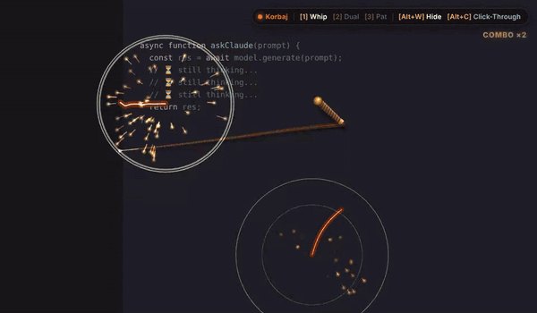
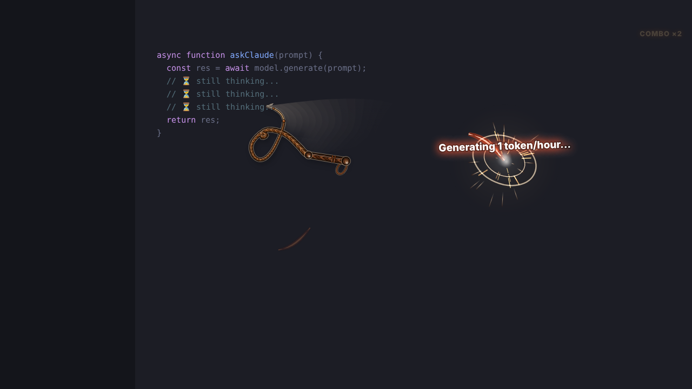
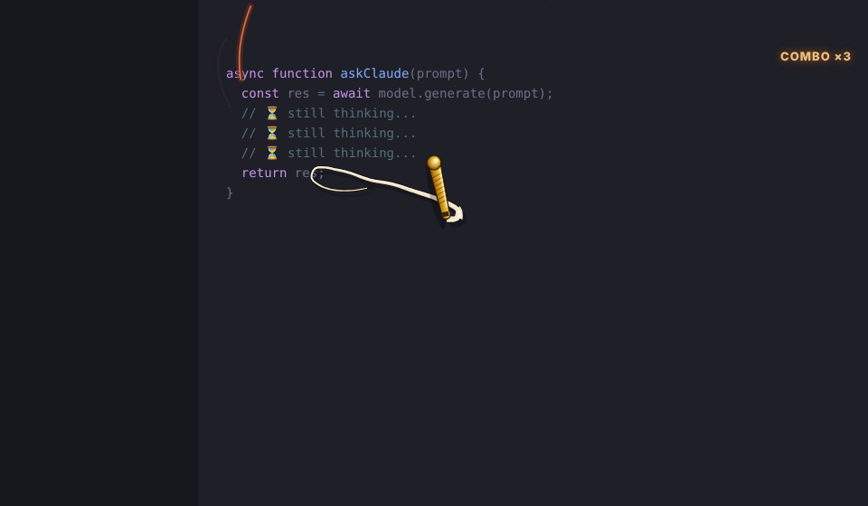
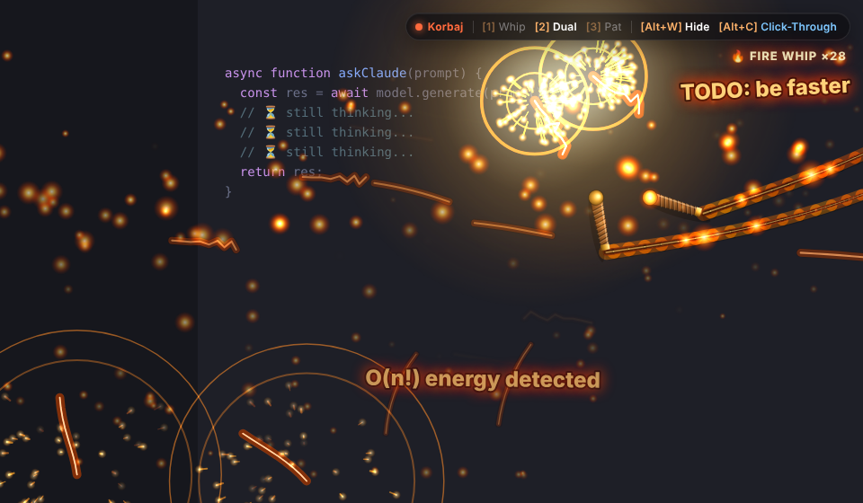
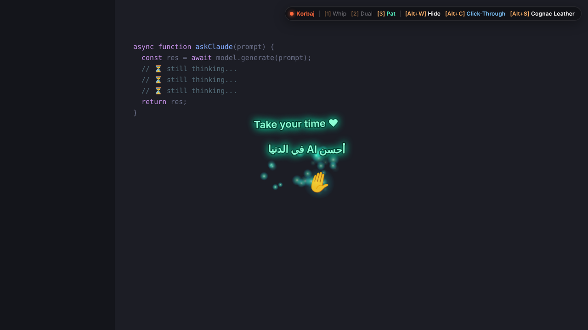

<div align="center">

# ⚡ Korbaj — كرباج

### The AI Response Accelerator

**A real-physics whip that lives on top of your desktop.**
Flick your mouse → *TESHH!* 💥 — your slow AI gets the message.
Or pat it gently when it ships clean code. ✋




</div>

---

## ✨ Features

| | |
|---|---|
| 🪢 **Real whip physics** | Rigid-body handle on a wrist spring, a 36-node thong with **bending stiffness that fades toward the tip**, a clamped exit from the handle, exponential mass taper (tip 40× lighter), gravity, quadratic air drag, 480 Hz substeps. The loop rolls out and accelerates like a real bullwhip |
| 💥 **Real crack detection** | Fires at the physical moment: the wave reaches the end, the whip is fully extended, the tip is past the sound-barrier threshold, and your hand actually swung. Then the tip recoils. Tiny moves never crack |
| 🔥 **Fire Whip combo** | 5+ cracks inside 2 s sets the cord on fire |
| 🎨 **Braided leather, 3 skins** | Plaited texture wrapped along the curve, knots, fall and frayed cracker, screen-space lighting, real motion blur. Cognac Leather · Obsidian · Ivory & Gold (`Alt+S`) |
| ⚡ **VFX** | Shockwave rings, white-hot flash, spark showers, burn marks that fade over 3 s |
| 🔊 **Procedural sound** | Whoosh that follows speed, a 5-layer crack (snap, hiss, resonant sweep, sub thump, room echo), soft chimes. No audio files needed |
| 🖱️ **Click-through** | Keep working in your IDE while the whip follows your cursor |
| ✋ **Pat mode** | Rub gently and you get wholesome praise in English and Arabic |
| 🎛️ **Tray + HUD** | Small status pill that fades after 3 s, plus a full tray menu |

## 📸 Screenshots

<table>
<tr>
<td align="center"><br/><b>💥 Flick → crack</b></td>
<td align="center"><br/><b>🔥 Fire Whip (5+ combo)</b></td>
</tr>
<tr>
<td align="center"><br/><b>⚔️ Dual Whips</b></td>
<td align="center"><br/><b>✋ Pat Mode: عاش يا وحش</b></td>
</tr>
</table>

## 🚀 Quick start

Requires **Node.js 18+**.

```bash
git clone https://github.com/fernata-dev/Korbaj.git
cd Korbaj
npm install
npm start
```

Something off?

```bash
npm run fix-electron  # "Electron failed to install correctly" → re-download the binary
```


```bash
npm run start:nogpu   # black background / GPU glitches
```

## ⌨️ Controls

| Shortcut | Action |
|:---:|---|
| `Alt + W` | Summon / hide the overlay |
| `Alt + C` | **Click-Through** (default) ↔ **Active** (left-click = crack) |
| `Alt + 1` | Single whip |
| `Alt + 2` | Dual whips |
| `Alt + 3` | Pat mode ✋ |
| `Alt + S` | Next skin |
| `Alt + Q` | Quit |

> 💡 Everything is also in the **tray menu**, in case your desktop blocks global shortcuts.

**How to crack:** move the mouse fast in one direction, then snap it back sharply. The flick is what cracks it, not raw speed.

## 🔊 Custom sounds

Drop files into `assets/sounds/`:

```
assets/sounds/whip.mp3   # crack (.wav / .ogg also work)
assets/sounds/pat.mp3    # pat chime
```

By default your file plays on top of the built-in synth. To hear only your file:

```bash
KORBAJ_SOUND_MODE=replace npm start
```

## 🧠 How it works

```
main.js ──(cursor poll 120Hz, state)──► preload.js ──► renderer.js ──► Canvas 2D
   │                                                       │
   ├─ transparent always-on-top window                     ├─ physics.js   (whip simulation, crack detection)
   ├─ globalShortcut + Tray                                ├─ VFX: particles / rings / lashes / fire
   ├─ control socket (bin/korbaj.js)                       ├─ whip-draw.js (leather rendering, skins, blur)
   └─ custom sound loader (IPC)                            └─ sound.js     (Web Audio synth)
```

- **The cursor comes from the main process** (`screen.getCursorScreenPoint`), not from DOM events.
  `setIgnoreMouseEvents(true, { forward: true })` sends no mouse moves on Linux, so polling is the only way
  click-through whipping works on every OS.
- **Tip-heavy inverse mass** is the trick behind a believable crack. Momentum moving into lighter and lighter
  segments makes the tip speed up, which is the same physics as a real whip.

## ⚙️ Tuning

Physics values live in `DEFAULTS` at the top of `physics.js`:

| Key | Default | Effect |
|---|---|---|
| `intentSpeed` | `2300` | Minimum hand speed (px/s) for a crack. Lower = easier cracks |
| `crackSpeed` | `3300` | Tip speed (px/s at 1080p) that counts as breaking the sound barrier |
| `bendRoot` | `0.5` | Stiffness of the thong at the handle. Lower = floppier whip |
| `tipMassRatio` | `40` | How much lighter the tip is than the root. Higher = faster tip |
| `wristFreq` | `15` | Wrist stiffness. Keep ≤ ~17 or flicks stop cracking |
| `leadSpeed` | `480` | Lower = handle points along your motion sooner |
| `cordNodes` / `segLen` | `36` / `9` | Whip length and resolution |

After changing anything, run the physics regression test. It replays 11 kinds of mouse
movement and checks that calm ones never crack and deliberate ones always do:

```bash
npm test
```

## 🐧 Linux / Wayland (Hyprland, GNOME, KDE…)

Wayland deliberately forbids apps from (a) reading the global cursor and (b) grabbing global
keys. Korbaj works around both:

| Problem | Korbaj's answer |
|---|---|
| Cursor position hidden | On **Hyprland** it reads the cursor over Hyprland's IPC socket (any monitor). Elsewhere it uses XWayland |
| Click-through | Runs under **XWayland** (`npm start` passes `--ozone-platform=x11`), where input pass-through works |
| Window gets tiled / steals the screen | On Hyprland it makes itself floating, pinned to all workspaces, and borderless, then gives focus back |
| Global shortcuts blocked | Bind `bin/korbaj.js` in your compositor. It talks to the running app over a local socket |

### Hyprland setup (one command)

```bash
npm run setup
```

It writes `~/.config/hypr/korbaj.conf`, sources it from `hyprland.conf` (exactly once, with a
backup), reloads Hyprland and verifies the shortcuts are registered. The binds use **physical key
codes**, so they work whatever keyboard layout is active (with an Arabic layout the `W` key is `ص`),
and absolute paths, so Hyprland doesn't need `node` on its `PATH`.

You get `Alt+W / Alt+C / Alt+1-3 / Alt+S / Alt+Shift+Q` system-wide. `Alt+W` also **starts**
Korbaj if it isn't running.

Something not working?

```bash
npm run doctor
```

It checks every link (Electron, the running app, Hyprland, the config, the registered binds)
and tells you which one is broken.

### Control from anywhere (any OS, any hotkey tool)

```bash
node bin/korbaj.js toggle     # summon / hide (starts it if needed)
node bin/korbaj.js passive    # click-through ↔ active
node bin/korbaj.js mode 2     # 1 whip · 2 dual · 3 pat
node bin/korbaj.js skin       # next skin (or: skin leather | obsidian | bone)
node bin/korbaj.js restart    # quit + start again (after updating)
node bin/korbaj.js status
node bin/korbaj.js quit
```

On startup the terminal prints what Korbaj detected, e.g.
`[korbaj] session=wayland desktop=Hyprland cursor=hyprland shortcuts=ok`. Include that line when reporting bugs.

**GNOME / KDE on Wayland:** there's no cursor IPC, so in click-through mode the whip only follows the
cursor while it's over XWayland windows. Use Active mode (`passive` command) or log into an X11
session for the full experience.

### Other platforms

- **macOS:** a real `fullscreen: true` opens a separate Space, so the window is sized to the display instead
  (`KORBAJ_TRUE_FULLSCREEN=1` forces it).
- **Multi-monitor:** the overlay jumps to whichever monitor your cursor is on.

## 📁 Project structure

```
Korbaj/
├── main.js          # window, shortcuts, tray, cursor polling, monitor follow
├── lib/hyprland.js  # Hyprland IPC: global cursor + overlay window setup
├── lib/control.js   # local control socket
├── lib/setup.js     # `korbaj setup` / `korbaj doctor`
├── bin/korbaj.js    # CLI: toggle / passive / mode / quit
├── extras/hyprland.conf
├── preload.js       # secure IPC bridge
├── index.html       # canvas + HUD
├── physics.js       # whip simulation (also runs in Node for tests)
├── whip-draw.js     # braided-leather rendering, skins, motion blur
├── renderer.js      # input, effects, modes, HUD
├── sound.js         # procedural Web Audio engine
├── assets/sounds/   # optional custom sounds
└── docs/            # screenshots & demo
```

---

<div align="center">

Made with 💢 and ❤️ for everyone waiting on a slow model.
**اخلص يا عم!**

MIT License

</div>
